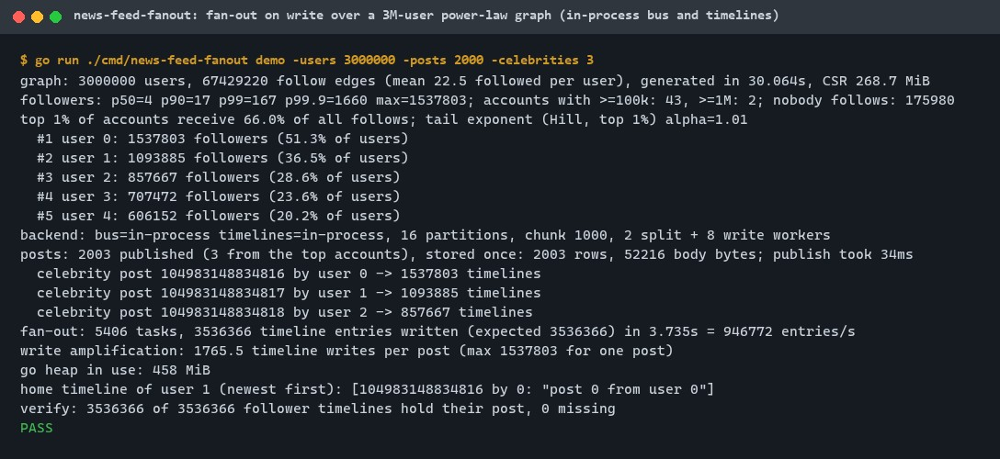
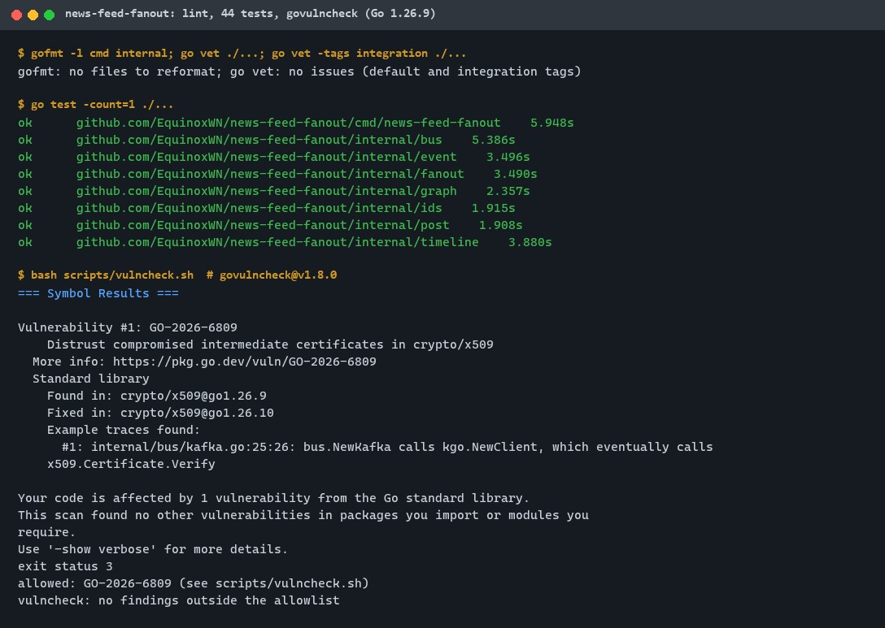
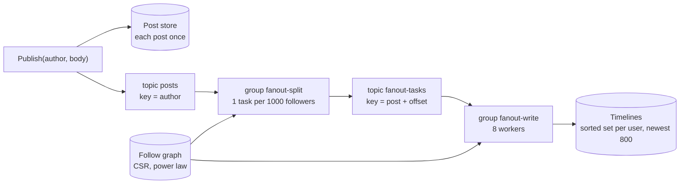
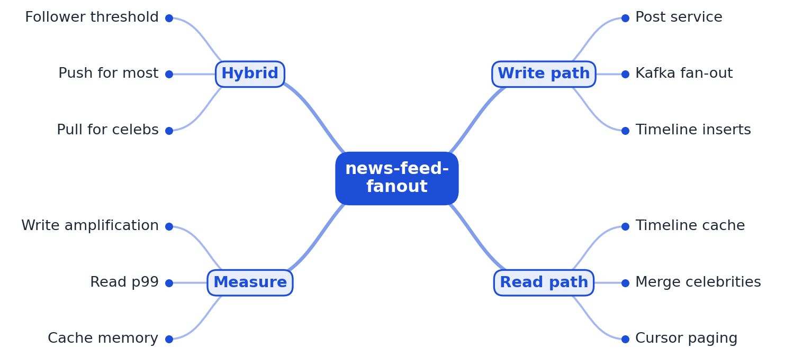

# news-feed-fanout

[](https://github.com/EquinoxWN/news-feed-fanout/actions/workflows/ci.yml)


> Serving a feed when one account has millions of followers, without melting the database: fan-out done the way real social apps do it.

Part of my **Backend and API** list · Go

## Proof it works

A 3-million-user power-law follow graph (two accounts with over a million followers each), 2,003
posts fanned out on write through the in-process bus into in-process timelines, and every one of the
3,536,366 follower timelines checked afterwards, 0 missing:



gofmt and go vet are clean, 44 tests pass, and govulncheck with Go 1.26.10 finds no vulnerabilities
(see [Tests and results](#tests-and-results)):



The same pipeline against real Kafka and Valkey is a CI job (`e2e`); its first CI run is pending, so
there are no Kafka or Valkey results yet.

## Architecture

**What M1 runs today:**



Kafka and Valkey sit behind two interfaces (`bus.Bus`, `timeline.Store`); local runs use the
in-process implementations, CI runs the Kafka (franz-go) and Valkey (RESP2) ones.

**Full roadmap (M1 to M3):**



## How it works

_Steps 1 and 2 are built and tested in-process (M1); the Kafka/Valkey run of step 2 is a CI job whose first run is pending; the rest is on the [roadmap](#roadmap)._

1. Posts are stored once; a synthetic follow graph has a realistic power-law shape, including a few accounts with millions of followers.
2. Fan-out on write pushes each new post ID into every follower's timeline (a Valkey sorted set) through Kafka workers.
3. For accounts above a follower threshold that is too expensive, so their posts are pulled and merged at read time instead.
4. Reads merge the precomputed timeline with recent celebrity posts and paginate with a cursor.
5. k6 measures write amplification, read p99 and cache memory for push-only, pull-only and hybrid.
6. The write-up shows how to pick the threshold from measured costs.

In M1 terms:

- **Graph:** each user follows 8 to 2,000 accounts (Pareto); who gets followed follows a Zipf law over
  popularity rank, so user 0 is the most followed. Same seed, same graph.
- **Post IDs:** 41 bits of milliseconds plus a 12-bit sequence, so an ID fits in 53 bits and is an
  exact sorted-set score.
- **Fan-out:** a splitter group turns each post into tasks of 1,000 followers; a writer group adds
  the post ID to each follower's timeline and trims it to the newest 800.
- **Delivery:** offsets are committed only after a message is handled; redelivered writes are
  no-ops, so no entry is lost or doubled.

## Who it helps

- **Who:** Backend engineers building or debugging a feed, and anyone preparing the "design the Twitter feed" interview question.
- **The problem:** Fan-out on write is easy to describe but its cost depends on the follower distribution; here it is measured on a generated graph with real celebrity accounts (3 of 2,003 posts caused 98.7% of all timeline writes).
- **How to use it:** Run `make bench` or `go run ./cmd/news-feed-fanout demo` with your own graph size, exponents, chunk size and worker counts, read the write-amplification and verification lines, and reuse the graph generator or the bus and timeline interfaces in your own experiments.

## Tech stack

| Area | In M1 | Planned |
|---|---|---|
| Core | Go 1.26, power-law graph generator (CSR), 53-bit time-ordered IDs, in-memory post store | PostgreSQL for posts and follows, outbox for the announce step |
| Feeds | Two-stage fan-out over consumer groups: in-process bus (tested locally), Kafka via franz-go (CI job, first run pending); timelines in-process or in Valkey sorted sets via a small RESP2 client (CI job, first run pending) | Pull for accounts above a threshold, read-time merge, cursor pagination |
| Test | Unit, randomized oracle, failure-injection, two fuzz targets, end-to-end demo | k6 load tests for push, pull and hybrid |
| CI | gofmt, go vet, `go test -race`, govulncheck; Kafka 4.1.0 and Valkey 8.1.4 service containers | |

Language: **Go**.

| Path | What it is |
|---|---|
| `cmd/news-feed-fanout` | CLI: `graph` (follower distribution) and `demo` (publish, fan out, verify) |
| `internal/graph` | Synthetic follow graph and its statistics |
| `internal/ids` | Post ID generator |
| `internal/post` | Post store (each post once, validated body) |
| `internal/event` | Binary `PostCreated` and `FanoutTask` messages |
| `internal/bus` | `Bus` interface, in-process partitioned log with consumer groups, Kafka adapter |
| `internal/timeline` | `Store` interface, in-process timelines, Valkey adapter and RESP2 client |
| `internal/fanout` | Publish service, splitter and writer workers, home-timeline read |

## Run it

Prerequisites: Go 1.26 or newer (CI uses 1.26.10). No Docker is needed for the in-process runs.

```bash
make setup     # download modules
make lint      # gofmt and go vet
make test      # all tests with the race detector (needs cgo; without a C compiler use: go test ./...)
make audit     # govulncheck through scripts/vulncheck.sh
make bench     # the 3M-user run behind the numbers below (about 0.5 GB of RAM)
```

Smaller runs:

```bash
go run ./cmd/news-feed-fanout graph -users 200000
go run ./cmd/news-feed-fanout demo -users 200000 -posts 1000 -chunk 500 -write-workers 4
```

Against Kafka and Valkey (what the CI `e2e` job runs):

```bash
NFF_KAFKA=localhost:9092 NFF_VALKEY=localhost:6379 make test-integration
go run ./cmd/news-feed-fanout demo -users 50000 -posts 500 -kafka localhost:9092 -valkey localhost:6379
```

## Tests and results

Latest local run (full detail in [docs/results/m1.md](docs/results/m1.md)): **44 passed, 0 failed**.

| Test file | Tests | What it proves |
|---|---|---|
| `cmd/news-feed-fanout/main_test.go` | 3 | The `demo` command runs end to end on a 30,000-user graph and verifies every timeline; `graph` prints the distribution; bad arguments are refused |
| `internal/bus/memory_test.go` | 7 | Per-key order across workers, redelivery of uncommitted messages after a handler error, independent groups, wake-up on late publish, one consumer per group, input checks |
| `internal/event/event_test.go` | 3 | Message round trip; truncated, oversized, wrong-version and out-of-range messages rejected; fuzz target |
| `internal/fanout/fanout_test.go` | 6 | A celebrity post reaches every follower; timelines match a brute-force oracle on 5 random graphs; with every 7th write failing, restarts converge with no lost or duplicate entries; validation |
| `internal/graph/graph_test.go` | 6 | Deterministic per seed, no self-follows or duplicates, heavy-tailed shape (Hill exponent, top-1% share, a 30%+ celebrity), paging bounds, config validation |
| `internal/ids/ids_test.go` | 5 | IDs strictly increase (also past 4,096 per millisecond and when the clock steps back), fit a float64 exactly, unique under concurrency |
| `internal/post/post_test.go` | 4 | A post is stored once (second put refused), lookups, body validation |
| `internal/timeline/timeline_test.go` | 5 | Newest first, idempotent adds, trim to the newest N (randomized), concurrent writers |
| `internal/timeline/valkey_test.go` | 5 | Valkey adapter against a loopback fake server (add, trim, latest, missing), concurrent pipelines, server errors, malformed RESP rejected; fuzz target |
| `internal/fanout/integration_test.go` | 1 | Kafka consumer groups and Valkey sorted sets end to end: **CI job written; first CI run pending** |

Headline results from the 3M-user run on this machine:

| Result | Value |
|---|---|
| Graph | 3,000,000 users, 67.4M follow edges; p50 4 followers, max 1,537,803; 2 accounts over 1M, 43 over 100k |
| Shape | top 1% of accounts receive 66.0% of follows; Hill tail exponent 1.01 |
| Posts | 2,003 published, 2,003 rows stored |
| Write amplification | 1,765.5 timeline writes per post on average; 1,537,803 for one celebrity post |
| Celebrity share of writes | 3 posts (0.15%) caused 98.7% of the 3,536,366 writes |
| Correctness | 3,536,366 of 3,536,366 follower timelines hold their post, 0 missing |
| Fan-out time (in-process) | 3.7 s in the recorded run, 0.13 s in an earlier one; the machine was shared with other builds, so these are single observations, not a benchmark |
| Fuzzing (10 s each) | event decoder about 795,000 inputs, RESP decoder about 33,000 inputs, 0 failures |
| govulncheck (Go 1.26.10) | No vulnerabilities found; `scripts/vulncheck.sh` fails on any finding |

Not run locally: the race detector (needs cgo) and the Kafka/Valkey tests; both are in CI.

## Roadmap

**M1** (≈8 h)
- [x] Write `docs/rfc/0001-design.md`: problem, goals, non-goals, chosen design
- [x] Posts are stored once; a synthetic follow graph has a realistic power-law shape, including a few accounts with millions of followers.
- [ ] Fan-out on write pushes each new post ID into every follower's timeline (a Valkey sorted set) through Kafka workers. Built and verified in-process (3.5M timeline writes, 0 missing); Kafka and Valkey: CI job written; first CI run pending.

**M2** (≈8 h)
- [ ] For accounts above a follower threshold that is too expensive, so their posts are pulled and merged at read time instead.
- [ ] Reads merge the precomputed timeline with recent celebrity posts and paginate with a cursor.

**M3** (≈9 h)
- [ ] k6 measures write amplification, read p99 and cache memory for push-only, pull-only and hybrid.
- [ ] The write-up shows how to pick the threshold from measured costs.
- [ ] Publish the proof below with real numbers

## Proof

What this repo must show before it counts as done:

- A push vs pull vs hybrid comparison, with the chosen threshold justified by data.

| Result | Value |
|---|---|
| M3 comparison above | Not measured yet (M3). Current M1 numbers: see [Tests and results](#tests-and-results). |

## Why it matters

- **Interview angle:** 'Design the Twitter / Instagram feed': one of the most-asked system design questions.
- **Upstream I'd like to contribute to:** CloudWeGo Kitex (ByteDance): examples or docs, if the services move to it.

## Design docs

- [RFC 0001: design](docs/rfc/0001-design.md)
- [ADR 0001: record architecture decisions](docs/adr/0001-record-architecture-decisions.md)
- [ADR 0002: split each post into chunked fan-out tasks](docs/adr/0002-two-stage-chunked-fanout.md)
- [ADR 0003: a small RESP2 client for Valkey instead of valkey-go](docs/adr/0003-small-resp-client.md)
- [M1 results](docs/results/m1.md)

## Scope

This is a learning and portfolio system, not a hosted production service. Everything runs locally;
Kafka and Valkey run only in CI service containers.

## Security and contributing

- Every GitHub Action is pinned to a commit SHA and every service image to a digest; workflows run read-only, without persisted credentials; service ports bind to localhost with memory limits.
- Dependabot update pull requests are paused (`open-pull-requests-limit: 0`) so the repository keeps a single `main` branch; dependencies are updated by hand and checked by the CI audit.
- Untrusted bytes are bounded: post bodies (1 KiB, UTF-8), bus messages (fixed length, range checks), RESP replies (line, bulk, array and depth limits); both decoders are fuzzed.
- Report vulnerabilities privately: see [SECURITY.md](SECURITY.md). To contribute, see [CONTRIBUTING.md](CONTRIBUTING.md).

## License

MIT, see [LICENSE](LICENSE).
